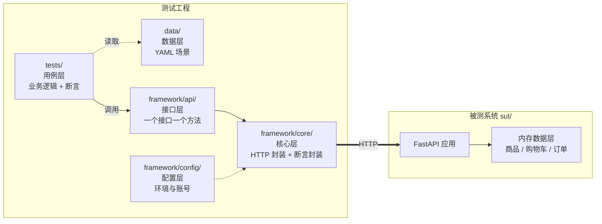
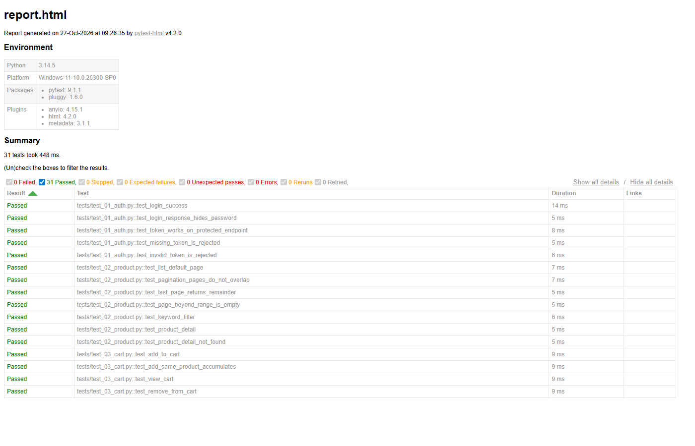

# 接口测试工程 · API Test Automation

[](https://github.com/tonyzho86/api-automation/actions/workflows/api-tests.yml)

基于 **Python + pytest + requests** 的接口测试工程:分层架构、数据驱动、JSON Schema 契约校验、CI 自动化。

工程内置一个**故意含有缺陷**的被测服务(SUT),用于验证测试用例能否真正发现参数边界、越权、幂等、金额计算等问题 —— 这也是接口测试的核心价值所在。

---

## 项目亮点

- **四层架构** —— 配置层 / 核心层 / 接口层 / 用例层。接口路径改版时只改一处,用例不动。
- **数据驱动** —— 测试场景写在 YAML 里,新增场景不需要改 Python 代码。
- **契约校验** —— 用 JSON Schema 断言响应结构,字段改名、类型变化能被立刻发现。
- **测试隔离** —— 每个用例前重置服务端数据,用例之间互不污染。
- **CI 闭环** —— 每次提交自动启动服务、执行测试、产出报告并归档。
- **缺陷靶场** —— 6 类真实缺陷,31 条正常用例 + 9 条缺陷追查用例。

---

## 架构



**分层的收益**:变化被关在最小范围里。

| 变化 | 需要改动的地方 |
|---|---|
| 换测试环境 | `.env` |
| 接口路径 / 参数改版 | `framework/api/` 一处 |
| 新增测试场景 | `data/*.yaml` |
| 新增断言 / 业务规则 | `tests/` |

更完整的设计说明见 [`docs/设计说明.md`](docs/设计说明.md)。

---

## 快速开始

**1. 安装依赖**

```bash
uv sync
```

**2. 启动被测服务(终端 1)**

```bash
uv run uvicorn sut.app:app --host 127.0.0.1 --port 18800
```

接口文档(自动生成):<http://127.0.0.1:18800/docs>

**3. 执行测试(终端 2)**

```bash
uv run pytest
```

报告输出到 `reports/report.html`(自包含单文件,浏览器直接打开)。

> Windows 用户可直接双击 `run-sut.cmd` / `run-tests.cmd`,已处理好 PATH 与中文编码。

---

## 测试结果

| 套件 | 命令 | 结果 |
|---|---|---|
| 正常用例 | `uv run pytest` | **31 passed** |
| 缺陷追查 | `uv run pytest -m bug` | **9 failed** —— 这 9 条红灯对应被测系统的 6 个真实缺陷 |



缺陷清单与根因见 [`sut/BUGS.md`](sut/BUGS.md)。修复 SUT 后重跑,全绿即为闭环。

---

## 目录结构

```
api-automation/
├── sut/                        # 被测系统(故意含缺陷)
│   ├── app.py                  # FastAPI 接口
│   ├── store.py                # 内存数据层
│   └── BUGS.md                 # 缺陷清单与根因
├── framework/                  # 测试框架(与具体业务解耦)
│   ├── config/settings.py      # 环境配置
│   ├── core/
│   │   ├── http_client.py      # 请求封装:统一地址/超时/日志/耗时
│   │   └── asserts.py          # 断言封装:失败时输出期望/实际/响应体
│   └── api/                    # 接口层:auth/product/cart/order
├── data/                       # 数据驱动
│   ├── order_cases.yaml
│   └── login_cases.yaml
├── tests/                      # 用例层
│   ├── conftest.py             # fixture 与测试隔离
│   ├── test_01_auth.py
│   ├── test_02_product.py
│   ├── test_03_cart.py
│   ├── test_04_order.py
│   ├── test_05_data_driven.py
│   └── test_06_bug_hunt.py     # 缺陷追查(默认不跑)
├── .github/workflows/          # CI
└── docs/                       # 设计说明与实战练习
```

---

## 常用命令

```bash
uv run pytest                 # 全部正常用例
uv run pytest -m smoke        # 冒烟用例
uv run pytest -m bug          # 缺陷追查(预期红灯)
uv run pytest -k "coupon"     # 按名字筛选
uv run pytest --lf            # 只重跑上次失败的
uv run pytest -x              # 第一个失败就停
```

---

## 技术栈

Python 3.14 · pytest · requests · jsonschema · PyYAML · FastAPI · GitHub Actions

---

## 说明

`sut/` 是教学用的**故意有缺陷**的服务,不是生产代码。缺陷位置在 `sut/app.py` 中有标注,答案在 `sut/BUGS.md`。

动手练习见 [`docs/实战练习.md`](docs/实战练习.md)。
